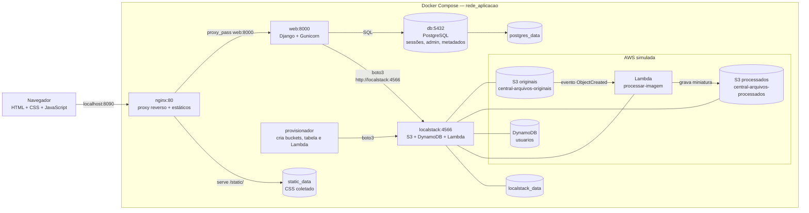
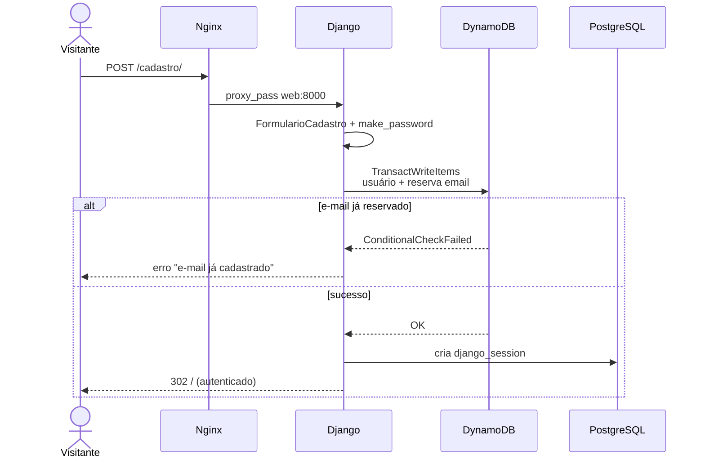
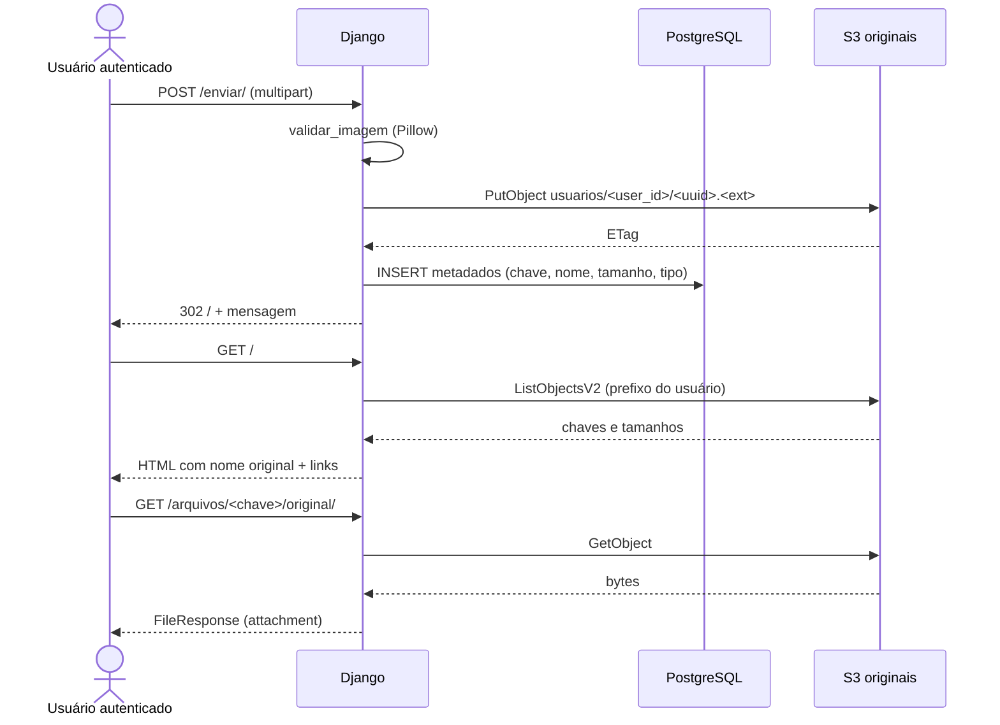

# Central de Arquivos — Django, S3, DynamoDB e Lambda no LocalStack

Aplicação web que reúne, em um único projeto Django, as três atividades do
enunciado:

1. **Amazon S3 (LocalStack):** upload, listagem e download de imagens.
2. **Amazon DynamoDB (LocalStack):** cadastro e autenticação de usuários.
3. **AWS Lambda (LocalStack):** processamento automático da imagem após o
   upload no S3, gerando uma miniatura em um segundo bucket.

A arquitetura original do repositório foi preservada: **Python, Django,
Gunicorn, Nginx, PostgreSQL, Docker e Docker Compose**. O LocalStack foi
acrescentado como ambiente AWS local, e o PostgreSQL continua tendo uma
função real (sessões, admin e metadados/auditoria).

> **Documentação de execução:** o passo a passo completo para subir, testar,
> parar e limpar o ambiente está em [COMANDOS.md](COMANDOS.md).
>
> **Diagramas:** a versão atualizada dos diagramas está em
> [docs/arquitetura.md](docs/arquitetura.md).

---

## 1. O que a aplicação faz

- Visitante cria conta com nome, e-mail e senha.
- A senha é transformada em hash pelo Django e o registro é gravado no
  **DynamoDB**.
- O login consulta o DynamoDB pelo e-mail e compara a senha com o hash
  armazenado.
- A sessão autenticada é mantida pelo Django no **PostgreSQL**.
- Usuário autenticado envia uma ou mais imagens.
- O Django valida o conteúdo real com **Pillow** e envia o binário ao bucket
  **`central-arquivos-originais`** no **S3/LocalStack**.
- A listagem consulta o próprio S3; o PostgreSQL apenas enriquece a tela com
  nome original e metadados.
- Cada upload no bucket de originais gera um evento `ObjectCreated` que
  aciona automaticamente a **Lambda**.
- A Lambda baixa a imagem, gera uma miniatura com largura máxima de **300 px**
  (proporção preservada) e grava o resultado no bucket
  **`central-arquivos-processados`**.
- O usuário pode baixar o original e a miniatura por rotas autenticadas do
  Django, que leem do S3.
- O bucket de processados **não tem gatilho**, evitando recursão.

---

## 2. Arquitetura



### Serviços do Docker Compose

| Serviço | Imagem / build | Porta publicada | Função |
|---|---|---|---|
| `db` | `postgres:16-alpine` | `127.0.0.1:15432` | Sessões Django, admin e metadados/auditoria |
| `localstack` | `localstack/localstack:3.8` | `127.0.0.1:4566` | S3, DynamoDB e Lambda simulados |
| `provisionador` | `infra/localstack/Dockerfile` | — | Cria buckets, tabela, índice, Lambda e evento S3 (one-shot) |
| `web` | `Dockerfile` | — | Django + Gunicorn na porta interna `8000` |
| `nginx` | `nginx:1.27-alpine` | `localhost:8090` | Proxy reverso e arquivos estáticos |

Volumes:

| Volume | Conteúdo |
|---|---|
| `postgres_data` | Banco PostgreSQL (sessões, admin, metadados) |
| `static_data` | CSS coletado por `collectstatic`; lido pelo Nginx |
| `localstack_data` | Estado do LocalStack (S3, DynamoDB e código da Lambda) |

O volume antigo `media_data` **não é mais usado**: o conteúdo das imagens agora
fica no S3, que é a fonte de verdade. Essa remoção é intencional e está
justificada na seção 7.

---

## 3. Onde cada tecnologia do enunciado é usada

### 3.1 Atividade 1 — S3 (LocalStack)

| Requisito | Onde está implementado |
|---|---|
| Enviar imagens do navegador ao backend | Formulário em `app/envios/templates/envios/pagina_inicial.html` e `enviar_arquivo.html`; view `enviar_arquivo` em `app/envios/views.py` |
| Validar tipo/tamanho | `app/envios/validacao.py` (`validar_imagem`) e `app/envios/forms.py` (`FormularioUploadImagens`) |
| Armazenar o conteúdo no bucket S3 | `app/envios/aws/arquivos.py` (`enviar_imagem` → `put_object`) |
| Listar os objetos do bucket | `listar_imagens_do_usuario` em `app/envios/aws/arquivos.py` (`list_objects_v2`) |
| Baixar cada imagem | Views `baixar_original` e `baixar_processado`; `obter_objeto` em `app/envios/aws/arquivos.py` |
| Atualizar o card quando a miniatura fica pronta | View `status_processado` (`HEAD` no bucket de processados) e polling em `app/envios/static/envios/app.js`, sem recarregar a página |
| O arquivo fica no S3, não em volume local | `docker-compose.yml` não monta mais `media_data`; o `FileField` local foi removido do model |
| Integração real com a API S3 do LocalStack | Cliente boto3 em `app/envios/aws/clientes.py` com `endpoint_url=http://localstack:4566` e path-style |

### 3.2 Atividade 2 — DynamoDB (LocalStack)

| Requisito | Onde está implementado |
|---|---|
| Tela/formulário de cadastro | `app/envios/templates/envios/cadastro.html`; `FormularioCadastro` em `app/envios/forms.py` |
| Validação dos dados | `FormularioCadastro.clean`, `clean_email` e `clean` |
| Gravar usuário na tabela DynamoDB | `criar_usuario` em `app/envios/aws/usuarios.py` (`TransactWriteItems`) |
| Tela/formulário de login | `app/envios/templates/envios/login.html`; `FormularioLogin` |
| Consultar o DynamoDB na autenticação | `buscar_usuario_por_email` (query no índice `email-index`) e `autenticar` |
| Senha com hash seguro | `make_password` no cadastro e `check_password` no login (hashers do Django, PBKDF2) |
| Sessão autenticada | `iniciar_sessao` em `app/envios/sessao.py`; sessão Django no PostgreSQL |
| Bloquear páginas privadas | `login_obrigatorio` em `app/envios/decorators.py` e `UsuarioDynamoDBMiddleware` |
| Logout | View `logout` (`POST`) e `encerrar_sessao` |
| E-mail duplicado | Item de reserva `email#<email>` + transação condicional no DynamoDB |

### 3.3 Atividade 3 — Lambda (LocalStack)

| Requisito | Onde está implementado |
|---|---|
| Criar a função Lambda no LocalStack | `garantir_lambda` em `infra/localstack/init_aws.py` |
| Configurar evento no bucket de originais | `configurar_eventos` (`s3:ObjectCreated:*`, prefixo `usuarios/`) |
| Acionar a Lambda automaticamente | Notificação do S3 configurada pelo provisionador; a aplicação nunca invoca a Lambda manualmente |
| Obter a imagem original | `handler` em `lambda/processar_imagem.py` (`S3.get_object`) |
| Processar a imagem | `gerar_miniatura`: Pillow, largura máxima de 300 px, proporção preservada, JPEG |
| Enviar resultado ao segundo bucket | `S3.put_object` para `central-arquivos-processados` |
| Mostrar/baixar o resultado | `listar_chaves_processadas`, `ver_processado` e `baixar_processado` |
| Evitar recursão | Saída em outro bucket; o bucket de processados recebe configuração de notificação vazia; a Lambda ignora eventos de outros buckets |

### 3.4 Demais tecnologias da arquitetura

| Tecnologia | Papel no projeto | Onde aparece |
|---|---|---|
| **Python 3.12** | Linguagem do backend e da Lambda | `Dockerfile`, `app/`, `lambda/`, `infra/` |
| **Django** | Rotas, formulários, validações, sessões, templates e integração AWS | `app/config/`, `app/envios/` |
| **Gunicorn** | Servidor WSGI que executa o Django | `entrypoint.sh`: `gunicorn config.wsgi:application --bind 0.0.0.0:8000` |
| **Nginx** | Proxy reverso e entrega de `/static/` | `nginx/default.conf` |
| **Docker** | Imagem própria do Django e imagem do provisionador | `Dockerfile`, `infra/localstack/Dockerfile` |
| **Docker Compose** | Orquestra `db`, `localstack`, `provisionador`, `web` e `nginx` | `docker-compose.yml` |
| **PostgreSQL** | Sessões (`django_session`), admin e metadados/auditoria | `settings.py` (`DATABASES`), `app/envios/models.py`, migration `0002_metadados_s3.py` |
| **LocalStack** | Simula S3, DynamoDB e Lambda | Serviço `localstack` no Compose; endpoint `http://localstack:4566` |
| **S3 — bucket original** | Guarda o binário original de cada imagem | `S3_BUCKET_ORIGINAIS`; `aws/arquivos.py`; Lambda lê daqui |
| **S3 — bucket processado** | Guarda as miniaturas JPEG | `S3_BUCKET_PROCESSADOS`; Lambda grava; views leem |
| **DynamoDB** | Fonte de verdade das contas e da autenticação | Tabela `usuarios`, índice `email-index`, `aws/usuarios.py` |
| **Lambda** | Processamento automático pós-upload | `lambda/processar_imagem.py`; provisionada por `init_aws.py` |
| **Boto3** | SDK que conversa com S3, DynamoDB e Lambda | `app/envios/aws/clientes.py`, `infra/localstack/init_aws.py`, `lambda/processar_imagem.py` |
| **Pillow** | Valida o conteúdo real da imagem e gera a miniatura | `app/envios/validacao.py` e `lambda/processar_imagem.py` |
| **HTML + CSS + JS** | Interface de cadastro, login, upload, listagem, download e atualização automática das miniaturas | `app/envios/templates/` e `app/envios/static/envios/` (`estilos.css` e `app.js`) |
| **JavaScript** | Mostra os nomes dos arquivos selecionados | `mostrarNomes` em `pagina_inicial.html` |

Não foi usado Node.js, Express ou Multer. Toda a lógica de backend permanece
em Python/Django.

---

## 4. Estrutura de diretórios

```text
.
├── app/
│   ├── manage.py
│   ├── config/
│   │   ├── settings.py              # PostgreSQL, sessões, AWS/LocalStack, limites
│   │   ├── urls.py                  # admin + rotas da aplicação
│   │   └── wsgi.py                  # entrada do Gunicorn
│   └── envios/
│       ├── aws/
│       │   ├── clientes.py          # clientes boto3 (S3 e DynamoDB)
│       │   ├── usuarios.py          # cadastro/consulta/autenticação no DynamoDB
│       │   └── arquivos.py          # upload/listagem/download no S3
│       ├── middleware.py            # carrega request.usuario do DynamoDB
│       ├── decorators.py            # login_obrigatorio
│       ├── sessao.py                # iniciar/encerrar sessão Django
│       ├── validacao.py             # validação real da imagem com Pillow
│       ├── forms.py                 # cadastro, login e upload múltiplo
│       ├── views.py                 # fluxos de cadastro, login, upload e download
│       ├── urls.py                  # rotas da aplicação
│       ├── models.py                # metadados/auditoria no PostgreSQL
│       ├── admin.py                 # histórico de envios no admin
│       ├── migrations/
│       │   ├── 0001_inicial.py
│       │   └── 0002_metadados_s3.py # remove FileField local e adiciona chave S3
│       ├── templates/envios/        # base, login, cadastro, listagem e upload
│       └── static/envios/           # CSS e JS da interface
├── lambda/
│   └── processar_imagem.py          # handler S3 -> Pillow -> bucket processados
├── infra/
│   └── localstack/
│       ├── Dockerfile               # empacota a Lambda com Pillow
│       ├── init_aws.py              # provisionamento idempotente
│       └── requirements-provisionamento.txt
├── nginx/default.conf               # proxy reverso e /static/
├── docs/arquitetura.md              # diagramas e decisões atualizadas
├── Dockerfile                       # imagem Django + Gunicorn
├── docker-compose.yml               # db, localstack, provisionador, web, nginx
├── executar.sh                      # atalho: sobe tudo e espera o provisionador
├── entrypoint.sh                    # espera Postgres, migrate, collectstatic, Gunicorn
├── requirements.txt                 # Django, Gunicorn, Psycopg, boto3, Pillow
├── .env.example                     # variáveis sem segredos reais
├── README.md
└── COMANDOS.md                      # passo a passo de execução e testes
```

---

## 5. Fluxos detalhados

### 5.1 Cadastro e login (DynamoDB)



1. O formulário valida nome, e-mail normalizado e confirmação de senha.
2. O Django gera o hash com `make_password` (PBKDF2, nunca texto puro).
3. `criar_usuario` grava **dois itens** na mesma transação:
   - o usuário, com `user_id` UUID;
   - uma reserva `email#<email>` para garantir unicidade.
4. Se a reserva já existir, a transação falha e a aplicação mostra erro.
5. A sessão Django é criada no PostgreSQL; o cookie guarda apenas o ID da
   sessão, e a sessão guarda apenas `usuario_id`/`usuario_email`.
6. Em cada requisição, `UsuarioDynamoDBMiddleware` consulta o DynamoDB pelo
   `user_id` e monta `request.usuario`.

No login:

1. `buscar_usuario_por_email` consulta o índice global `email-index`.
2. `autenticar` usa `check_password` contra o `senha_hash` recuperado.
3. Se válido, `iniciar_sessao` rotaciona a chave da sessão (`cycle_key`) e
   grava o identificador da conta.
4. Se inválido, a resposta é genérica: “E-mail ou senha inválidos”.
5. Logout faz `session.flush()` e exige `POST` com CSRF.

### 5.2 Upload, listagem e download (S3)



- A chave é gerada com UUID, sem usar o nome enviado pelo navegador:
  `usuarios/<user_id>/<uuid>.<extensão>`.
- A extensão vem do formato detectado pelo Pillow, não do nome do arquivo.
- A listagem é feita no S3, com prefixo `usuarios/<user_id>/`.
- O PostgreSQL é consultado em lote apenas para recuperar `nome_original`,
  tamanho e data; se o metadado não existir, a chave S3 ainda é listada.
- O download passa por uma view autenticada; o Nginx **não** serve `/media/`.
- A chave é validada contra o prefixo do usuário da sessão e contra `..`,
  impedindo acesso a arquivos de outra conta.

### 5.3 S3 → evento → Lambda → bucket de processados

```mermaid
sequenceDiagram
    participant D as Django
    participant So as S3 originais
    participant L as Lambda
    participant Sp as S3 processados
    actor U as Usuário

    D->>So: PutObject usuarios/<uid>/<uuid>.png
    So-->>L: evento s3:ObjectCreated:*
    L->>So: GetObject
    So-->>L: bytes da imagem
    L->>L: Pillow: largura máxima 300 px
    L->>Sp: PutObject usuarios/<uid>/<uuid>_thumb.jpg
    U->>D: GET / (lista inicial)
    D->>Sp: ListObjectsV2
    Sp-->>D: chaves das miniaturas
    D-->>U: cards; pendentes com data-status-url
    loop a cada 2,5 s enquanto houver card pendente
        U->>D: GET /arquivos/<chave>/status/
        D->>Sp: HeadObject <uuid>_thumb.jpg
        Sp-->>D: existe?
        D-->>U: {"processada": true|false}
    end
    U->>D: GET /arquivos/<chave>/miniatura/
    D->>Sp: GetObject
    Sp-->>D: JPEG
    D-->>U: miniatura
```

- O evento é configurado **no bucket de originais**, com filtro de prefixo
  `usuarios/`.
- A Lambda grava no bucket de processados, que não tem notificação.
- O handler também ignora eventos cujo bucket não seja o de originais,
  como defesa extra contra recursão.
- A listagem verifica quais chaves `_thumb.jpg` já existem no bucket de
  processados. Enquanto a Lambda não termina, o card mostra
  “Processando pela Lambda...”. O JavaScript consulta o endpoint de status a
  cada 2,5 s e troca o card pela miniatura assim que o objeto aparece, sem
  recarregar a página. O botão “Atualizar lista” continua disponível como
  fallback.
- A primeira invocação pode demorar porque o LocalStack baixa a imagem
  `public.ecr.aws/lambda/python:3.12` para executar a função.

---

## 6. Modelo de dados

### 6.1 DynamoDB — tabela `usuarios`

- Chave primária: `user_id` (string, UUID).
- Índice global: `email-index`, partição por `email`, projeção `ALL`.
- Item de usuário:

```json
{
  "user_id":       {"S": "8f14e45f-ceea-467f-a8f5-1b2c3d4e5f60"},
  "tipo":          {"S": "usuario"},
  "nome":          {"S": "Maria Silva"},
  "email":         {"S": "maria@exemplo.com"},
  "senha_hash":    {"S": "pbkdf2_sha256$1000000$...$..."},
  "data_cadastro": {"S": "2026-11-19T12:00:00+00:00"}
}
```

- Item de reserva de e-mail:

```json
{
  "user_id":           {"S": "email#maria@exemplo.com"},
  "tipo":              {"S": "reserva_email"},
  "email_normalizado": {"S": "maria@exemplo.com"},
  "criado_em":         {"S": "2026-11-19T12:00:00+00:00"}
}
```

O item de reserva **não possui o atributo `email`**, portanto não aparece no
índice `email-index`. A gravação dos dois itens usa `TransactWriteItems` com
`attribute_not_exists(user_id)`: duas requisições simultâneas com o mesmo
e-mail não criam contas duplicadas. O e-mail é sempre normalizado
(`strip().lower()`).

> O DynamoDB é a fonte de verdade das contas da aplicação. O usuário padrão
> do Django/PostgreSQL existe apenas para o **admin** interno, não é usado no
> cadastro nem no login da Central de Arquivos.

### 6.2 PostgreSQL — modelo `ArquivoEnviado`

| Campo | Tipo | Uso |
|---|---|---|
| `id` | BigAutoField | Identificador interno |
| `proprietario_id` | CharField(64), indexado | `user_id` do DynamoDB |
| `proprietario_email` | EmailField | Auditoria |
| `chave_s3` | CharField(512), único, nulo | Caminho do objeto no bucket original |
| `nome_original` | CharField(255) | Nome exibido na listagem |
| `tamanho_em_bytes` | PositiveBigIntegerField | Tamanho do original |
| `content_type` | CharField(100) | Tipo detectado pelo Pillow |
| `enviado_em` | DateTimeField | Data/hora do upload |

O conteúdo binário **não** está nesse modelo. O PostgreSQL guarda somente
metadados/auditoria. A migration `0002_metadados_s3.py` remove o antigo
`FileField` local e adiciona os campos acima.

### 6.3 S3 — convenção de chaves

```text
central-arquivos-originais/
└── usuarios/<user_id>/<uuid>.<ext>          # original

central-arquivos-processados/
└── usuarios/<user_id>/<uuid>_thumb.jpg      # miniatura gerada pela Lambda
```

A mesma função de derivação (`<base>_thumb.jpg`) existe em
`app/envios/aws/arquivos.py` e em `lambda/processar_imagem.py`. Como a Lambda
não importa Django, a regra é duplicada de forma explícita e documentada.

---

## 7. Decisões arquiteturais

### Por que o PostgreSQL foi mantido

- **Sessões Django:** `django.contrib.sessions` usa a tabela `django_session`
  no PostgreSQL. A verificação de credenciais, porém, é feita no DynamoDB.
- **Admin:** o admin do Django continua disponível para inspeção interna e
  usa o usuário padrão do Django. Ele não substitui as contas da aplicação.
- **Metadados/auditoria:** o histórico de envios e a associação
  `user_id → chave S3` ficam no PostgreSQL, sem duplicar o conteúdo binário.

### Por que o volume `media_data` foi removido

O enunciado exige que a imagem fique no S3, e não apenas em uma pasta/volume
local. Manter `media_data` daria duas fontes de verdade e permitiria que o
Nginx servisse arquivos sem autenticação. Por isso:

- o `FileField` local foi removido do model;
- o Compose não monta mais `media_data`;
- o Nginx não serve mais `/media/`;
- uploads e downloads passam pelo S3 e por views autenticadas.

O volume `media_data` de instalações antigas não é apagado automaticamente.
Ele simplesmente deixa de ser usado. Não execute `docker compose down -v` sem
querer apagar também o PostgreSQL, o LocalStack e os volumes antigos.

### Por que a Lambda não é invocada pela aplicação

A aplicação apenas faz `PutObject` no bucket de originais. Quem invoca a
Lambda é o evento `s3:ObjectCreated:*` configurado no LocalStack. Não existe
botão nem endpoint que chame a Lambda manualmente; a única forma de gerar a
miniatura é o upload no bucket correto.

### LocalStack 3.8 e licenciamento

O Compose fixa `localstack/localstack:3.8` para manter o funcionamento sem
token de autenticação e com persistência local. Versões mais novas do
LocalStack (a partir das mudanças de licenciamento de 2025/2026) podem exigir
uma conta/workspace e um `LOCALSTACK_AUTH_TOKEN` (plano Hobby gratuito para uso
não comercial ou planos pagos). Se o ambiente do avaliador usar uma versão
nova, será necessário criar o token e adicioná-lo ao `.env`/Compose; o código
da aplicação não muda. Consulte a documentação oficial de licenciamento antes
de trocar a tag da imagem.

A Lambda do LocalStack executa containers Docker reais. Por isso o serviço
monta `/var/run/docker.sock` e usa `LAMBDA_DOCKER_NETWORK=rede_aplicacao`.
Sem esse socket, a função fica em `Pending`/`Failed` com “Docker not
available”.

---

## 8. Segurança implementada

- **Senhas:** `make_password`/`check_password` do Django (PBKDF2). O hash
  nunca é devolvido ao frontend nem gravado em logs.
- **Sessão:** `cycle_key()` no login, cookie `HttpOnly`, `SameSite=Lax`,
  expiração de 8 horas. A sessão guarda apenas o identificador da conta.
- **CSRF:** todos os formulários `POST` usam ``; logout é
  `POST` e usa `@require_POST`.
- **Autorização:** o `user_id` vem sempre da sessão, nunca de um campo do
  formulário. A chave S3 é validada contra `usuarios/<user_id>/` e contra
  segmentos `..`.
- **Validação de upload:** o conteúdo é aberto pelo Pillow; extensão e MIME do
  navegador não são confiáveis. São aceitos JPEG, PNG, GIF e WEBP, com limite
  de 10 MB por imagem e 5 imagens por envio (configurável).
- **Buckets privados:** nenhum bucket é tornado público; o download é feito
  por view autenticada.
- **Nginx:** `client_max_body_size 55m`, compatível com 5 × 10 MB.
- **Erros:** mensagens amigáveis ao usuário; detalhes técnicos apenas nos logs,
  sem senhas ou hashes.
- **Credenciais:** apenas valores fictícios (`test`/`test`) para o LocalStack;
  `.env` está no `.gitignore` e `.env.example` não contém segredos reais.
- **Open redirect:** o parâmetro `next` do login é validado com
  `url_has_allowed_host_and_scheme`.

---

## 9. Configuração e execução

O passo a passo detalhado está em [COMANDOS.md](COMANDOS.md). Resumo:

```bash
cd django-upload-docker
cp .env.example .env          # se ainda não existir um .env
docker compose up --build -d
```

Ou use o atalho `./executar.sh`, que confere Docker/Compose, sobe os containers
e espera o provisionamento terminar.

Acesse **http://localhost:8090**. O LocalStack fica em
**http://localhost:4566** e o PostgreSQL em **localhost:15432**.

Principais variáveis do `.env`:

| Variável | Padrão | Função |
|---|---|---|
| `PORTA_NGINX` | `8090` | Porta HTTP publicada |
| `PORTA_LOCALSTACK` | `4566` | Porta do LocalStack publicada em `127.0.0.1` |
| `AWS_ENDPOINT_URL` | `http://localstack:4566` | Endpoint interno usado pelo Django |
| `AWS_REGION` | `us-east-1` | Região simulada |
| `AWS_ACCESS_KEY_ID` / `AWS_SECRET_ACCESS_KEY` | `test` / `test` | Credenciais fictícias |
| `S3_BUCKET_ORIGINAIS` | `central-arquivos-originais` | Bucket dos uploads |
| `S3_BUCKET_PROCESSADOS` | `central-arquivos-processados` | Bucket das miniaturas |
| `DYNAMODB_TABLE_USUARIOS` | `usuarios` | Tabela de contas |
| `DYNAMODB_INDICE_EMAIL` | `email-index` | Índice global de e-mail |
| `LAMBDA_FUNCAO` | `processar-imagem` | Nome da função no LocalStack |
| `LARGURA_MAXIMA_MINIATURA` | `300` | Largura máxima da miniatura |
| `LIMITE_TAMANHO_IMAGEM_MB` | `10` | Limite por imagem |
| `LIMITE_ARQUIVOS_POR_ENVIO` | `5` | Limite de imagens por envio |

A ordem de inicialização é garantida pelo Compose:

```text
db (healthy) ──────────────┐
                           ├──> web ──> nginx
localstack (healthy) ──> provisionador (completo) ──┘
```

O `provisionador` só termina depois de criar os dois buckets, a tabela com o
índice ativo, a função Lambda, a permissão e o evento S3. O `web` só inicia
depois que ele termina com sucesso.

---

## 10. Roteiro de testes

Os comandos completos estão em [COMANDOS.md](COMANDOS.md). Resumo dos testes
obrigatórios:

### Atividade 1 — S3

- [ ] Subir o LocalStack e confirmar os dois buckets.
- [ ] Enviar uma imagem e verificar o objeto no bucket original.
- [ ] Confirmar que a imagem aparece na listagem e que a miniatura surge
      automaticamente quando a Lambda termina.
- [ ] Baixar o original e comparar o conteúdo.
- [ ] Enviar arquivo inválido (texto com extensão `.png`) e confirmar erro.
- [ ] Enviar arquivo acima de 10 MB e confirmar erro.

### Atividade 2 — DynamoDB

- [ ] Criar conta e confirmar o item na tabela `usuarios`.
- [ ] Confirmar que `senha_hash` é um hash e não a senha original.
- [ ] Tentar cadastrar o mesmo e-mail e confirmar erro.
- [ ] Fazer login correto e acessar a área privada.
- [ ] Fazer login com senha errada e confirmar erro.
- [ ] Abrir `/` sem sessão e confirmar redirecionamento para `/login/`.
- [ ] Fazer logout e confirmar que a área privada volta a ser bloqueada.

### Atividade 3 — Lambda

- [ ] Enviar uma imagem ao bucket original.
- [ ] Confirmar o evento e a invocação nos logs do LocalStack.
- [ ] Confirmar o arquivo `_thumb.jpg` no bucket de processados.
- [ ] Verificar que a miniatura tem largura máxima de 300 px e proporção
      preservada.
- [ ] Confirmar que o bucket de processados não tem notificação configurada.
- [ ] Confirmar que a aplicação mostra “Processada” e permite baixar a
      miniatura.

### Persistência e reinício

- [ ] `docker compose down` (sem `-v`) e `docker compose up -d`: dados do
      PostgreSQL, S3, DynamoDB e Lambda continuam.
- [ ] `docker compose down -v` em ambiente descartável: tudo é recriado pelo
      provisionador no próximo `up`.

---

## 11. Validação realizada neste ambiente

O shell do assistente roda em um sandbox Flatpak/bwrap e não tem o binário
`docker`. Porém, o LocalStack do ambiente estava em execução e acessível em
`127.0.0.1:4566`, então a integração real com S3, DynamoDB e Lambda foi
validada, além dos testes locais:

| Verificação | Resultado |
|---|---|
| `python -m compileall app lambda infra` | OK |
| `python manage.py check` | Nenhum problema |
| `python manage.py makemigrations --check --dry-run` | Nenhuma alteração pendente |
| `node --check app/envios/static/envios/app.js` | OK |
| Validação de imagem com Pillow (válida/inválida) | OK |
| Miniatura 800×600 → 300×225 e imagem 200×100 sem upscale | OK |
| Formulário de upload múltiplo (2 arquivos) | OK |
| Renderização de `/login/`, `/cadastro/` e bloqueio de `/` sem sessão | OK |
| DynamoDB real: cadastro, hash, e-mail duplicado, login correto/errado | OK |
| S3 real: upload, listagem, download e isolamento por usuário | OK |
| Evento S3 → Lambda → bucket de processados, disparado automaticamente | OK |
| Miniatura real gerada pela Lambda: 800×600 → 300×225 JPEG | OK |
| Endpoint `/arquivos/<chave>/status/` antes e depois da Lambda | OK |
| Isolamento entre contas no status e nos downloads | OK |
| Navegador: login, cadastro, upload, drag-and-drop e atualização automática do card | OK |

O que ainda depende do terminal do usuário:

1. Rebuild do container `web` para servir os templates/CSS/JS novos em
   `http://localhost:8090`: `docker compose up -d --build web` ou
   `./executar.sh`.
2. Confirmar o fluxo completo através do Nginx/Gunicorn no host.

O [COMANDOS.md](COMANDOS.md) traz os comandos exatos para essa validação.

---

## 12. Critérios de aceitação

| Critério | Situação |
|---|---|
| Projeto continua em Django/Python | Atendido |
| Nginx e Gunicorn continuam funcionando | Configurados; rebuild do `web` pendente para validar a UI nova pelo Nginx |
| Docker Compose sobe o ambiente completo | Configurado; o shell do assistente não tem Docker, mas o LocalStack do host foi usado nos testes |
| LocalStack disponibiliza S3, DynamoDB e Lambda | Validado no LocalStack real |
| Imagens armazenadas no bucket S3 | Implementado e testado no S3 real |
| Aplicação lista imagens do S3 | Implementado e testado |
| Download recupera do S3 | Implementado e testado |
| Cadastro grava usuário no DynamoDB | Implementado e testado no DynamoDB real |
| Login consulta DynamoDB e verifica hash | Implementado e testado no DynamoDB real |
| Sessões e logout funcionam | Implementado e testado |
| Upload no bucket original aciona a Lambda | Validado automaticamente no LocalStack real |
| Lambda processa e envia a outro bucket | Validado no LocalStack real (300×225 JPEG) |
| Aplicação permite visualizar/baixar o resultado | Implementado e testado |
| Miniatura aparece sem recarregar a página | Implementado e validado no navegador |
| README explica execução e testes de ponta a ponta | Atendido (README + COMANDOS.md) |
| Nenhuma credencial real ou senha em texto puro | Atendido |

---

## 13. Documentação relacionada

- [COMANDOS.md](COMANDOS.md) — subir, testar, inspecionar e limpar o ambiente.
- [docs/arquitetura.md](docs/arquitetura.md) — diagramas de implantação,
  componentes, sequência e persistência atualizados.
