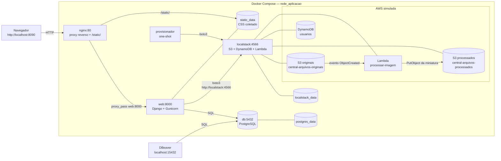
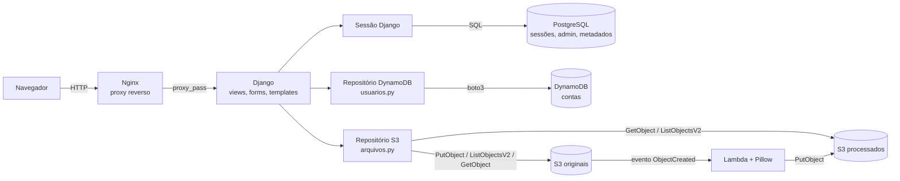
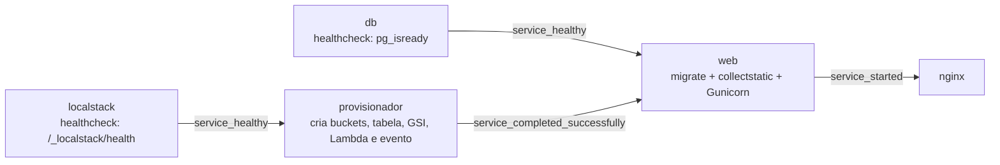
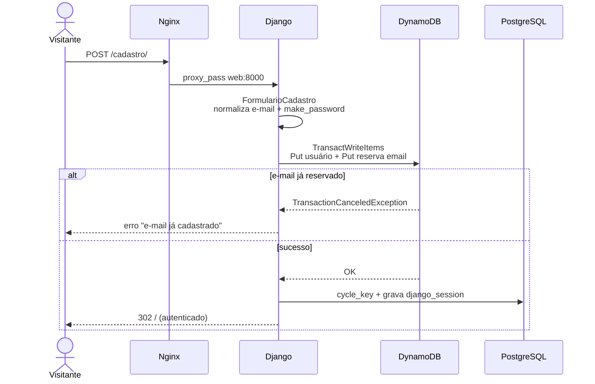
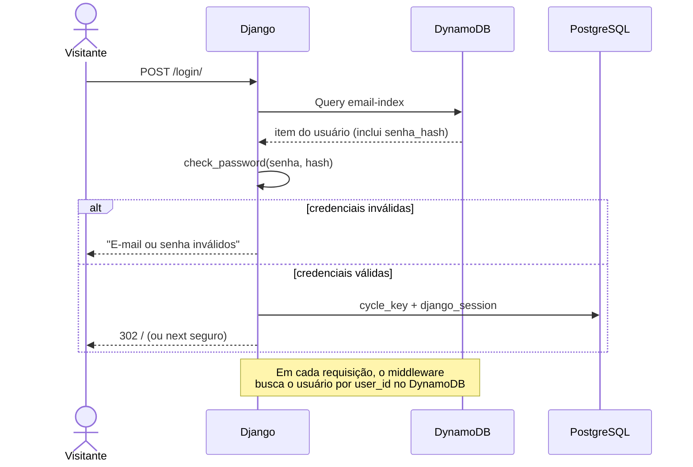
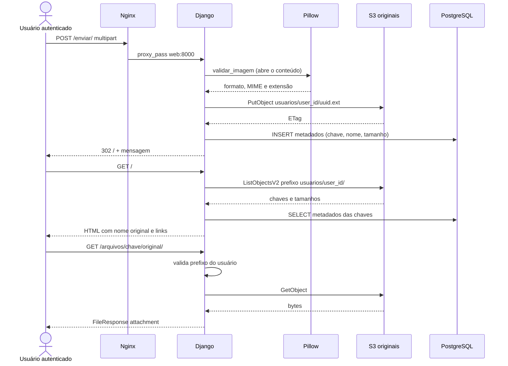
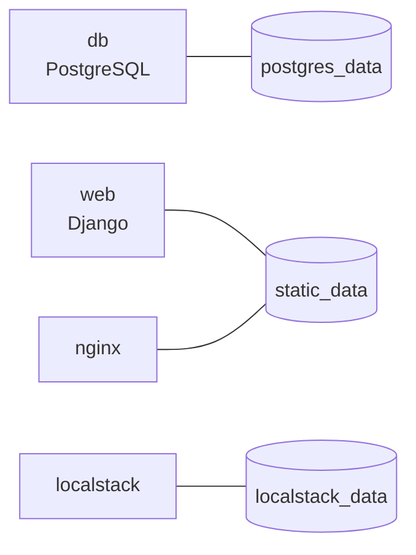

# Arquitetura da solução

Este arquivo é a fonte central dos diagramas da **Central de Arquivos**. Ele
descreve a versão adaptada para o LocalStack, com:

- **Django + Gunicorn** para a aplicação web;
- **Nginx** como proxy reverso e servidor de estáticos;
- **PostgreSQL** para sessões, admin e metadados/auditoria;
- **LocalStack** simulando **S3**, **DynamoDB** e **Lambda**;
- **boto3** para integração com os serviços AWS;
- **Pillow** para validar imagens e gerar miniaturas.

O `README.md` apresenta a visão geral, a explicação de cada tecnologia e os
critérios de aceitação. O passo a passo de execução está em
[`../COMANDOS.md`](../COMANDOS.md).

---

## 1. Visão geral

A aplicação mantém três fontes de verdade bem separadas:

| Dado | Fonte de verdade | Uso |
|---|---|---|
| Contas e credenciais | **DynamoDB** (`usuarios`) | Cadastro e login da aplicação |
| Conteúdo das imagens | **S3** (`central-arquivos-originais`) | Upload, listagem e download |
| Miniaturas | **S3** (`central-arquivos-processados`) | Resultado da Lambda |
| Sessões, admin e metadados | **PostgreSQL** | Sessão Django, admin e auditoria |

O PostgreSQL **não** é usado para autenticar os usuários da aplicação. Ele
continua tendo um papel real: guardar a sessão do Django, o admin interno e o
histórico de envios (`ArquivoEnviado`). O conteúdo binário das imagens não é
gravado em volume local; fica no S3.

---

## 2. Diagrama de implantação

Mostra **onde** cada componente executa, as portas publicadas e internas, os
volumes e a rede Docker.



Portas:

| Serviço | Porta publicada | Porta interna |
|---|---|---|
| Nginx | `localhost:8090` (`PORTA_NGINX`) | `80` |
| PostgreSQL | `127.0.0.1:15432` | `5432` |
| LocalStack | `127.0.0.1:4566` (`PORTA_LOCALSTACK`) | `4566` |
| Django/Gunicorn | não publicada | `8000` |

O LocalStack executa a Lambda em **containers Docker reais**. Por isso o
serviço monta `/var/run/docker.sock` e define
`LAMBDA_DOCKER_NETWORK=rede_aplicacao`. A rede do Compose tem o nome explícito
`rede_aplicacao` para que o container da Lambda consiga resolver
`localstack:4566`.

---

## 3. Diagrama de componentes

Mostra **como** as responsabilidades colaboram, sem confundir componentes
lógicos com containers.



O Diagrama de Implantação responde **onde** cada elemento executa. O Diagrama
de Componentes responde **quem faz o quê**.

---

## 4. Ordem de inicialização

A ordem é definida no `docker-compose.yml`:



1. `db` e `localstack` sobem com healthcheck.
2. `provisionador` espera o LocalStack ficar saudável e cria, de forma
   **idempotente**:
   - os dois buckets;
   - a tabela `usuarios` e o índice `email-index` (aguardando o GSI ficar
     `ACTIVE`);
   - a função Lambda com o zip que contém Pillow;
   - a permissão `lambda:InvokeFunction` para o S3;
   - a notificação `s3:ObjectCreated:*` no bucket de originais;
   - a remoção de qualquer notificação no bucket de processados.
3. `web` só inicia depois que o `provisionador` termina com sucesso. O
   `entrypoint.sh` espera o PostgreSQL, roda `migrate`, `collectstatic` e
   inicia o Gunicorn.
4. `nginx` inicia depois do `web` e passa a publicar a aplicação em
   `localhost:8090`.

O `provisionador` pode ser reexecutado sem recriar recursos já existentes; ele
atualiza o código da Lambda e reaplica a notificação do S3.

---

## 5. Cadastro de usuário (DynamoDB)



Detalhes:

1. O formulário valida nome, e-mail normalizado (`strip().lower()`) e
   confirmação de senha.
2. O Django gera o hash com `make_password` (PBKDF2). A senha em texto puro
   nunca é gravada.
3. `criar_usuario` grava **dois itens na mesma transação**:
   - o usuário, com `user_id` UUID, `tipo=usuario` e `senha_hash`;
   - a reserva `email#<email>`, com `tipo=reserva_email`.
4. As duas condições usam `attribute_not_exists(user_id)`. Duas requisições
   simultâneas com o mesmo e-mail não criam contas duplicadas.
5. O item de reserva **não** possui o atributo `email`, então não aparece no
   índice `email-index`.
6. A sessão Django é criada no PostgreSQL. O cookie guarda apenas o ID da
   sessão; a sessão guarda apenas `usuario_id` e `usuario_email`.

---

## 6. Login e sessão (DynamoDB + PostgreSQL)



Detalhes:

- `buscar_usuario_por_email` consulta o índice global `email-index`.
- `autenticar` usa `check_password` contra o `senha_hash` recuperado.
- Em caso de sucesso, `iniciar_sessao` chama `cycle_key()` e grava o
  identificador da conta.
- Em caso de falha, a mensagem é genérica para não revelar se o e-mail existe.
- `UsuarioDynamoDBMiddleware` consulta o DynamoDB pelo `user_id` em cada
  requisição e monta `request.usuario`.
- Se a conta for removida do DynamoDB, a sessão é descartada. Se o DynamoDB
  estiver temporariamente indisponível, a sessão é preservada e a view mostra
  uma mensagem de erro.
- Logout faz `session.flush()` e exige `POST` com CSRF.

---

## 7. Upload, listagem e download (S3)



Regras importantes:

- A extensão e o MIME informados pelo navegador **não** são confiáveis. O
  Pillow abre o conteúdo real e identifica o formato. São aceitos JPEG, PNG,
  GIF e WEBP.
- A chave é gerada com UUID: `usuarios/<user_id>/<uuid>.<extensão>`. O nome
  original fica apenas no metadado do PostgreSQL.
- A listagem consulta o **S3** (`ListObjectsV2` com prefixo do usuário). O
  PostgreSQL é usado apenas para enriquecer a tela com nome original,
  tamanho e data.
- O download passa por uma view autenticada. A chave é validada contra o
  prefixo `usuarios/<user_id>/` da sessão e contra segmentos `..`. O Nginx não
  serve `/media/`.
- Se o registro no PostgreSQL falhar depois do `PutObject`, a imagem continua
  listada porque o S3 é a fonte de verdade; o metadado é apenas auditoria.

---

## 8. S3 → evento → Lambda → bucket de processados

```mermaid
sequenceDiagram
    participant D as Django
    participant So as S3 originais
    participant L as Lambda
    participant Sp as S3 processados
    actor U as Usuário

    D->>So: PutObject usuarios/user_id/uuid.ext
    So-->>L: evento s3:ObjectCreated:*
    L->>So: GetObject
    So-->>L: bytes da imagem
    L->>L: Pillow: largura máxima 300 px<br/>proporção preservada, JPEG
    L->>Sp: PutObject usuarios/user_id/uuid_thumb.jpg
    U->>D: GET / (lista inicial)
    D->>Sp: ListObjectsV2 prefixo do usuário
    Sp-->>D: chaves _thumb.jpg
    D-->>U: cards; pendentes com data-status-url
    loop a cada 2,5 s enquanto houver pendente
        U->>D: GET /arquivos/<chave>/status/
        D->>Sp: HeadObject uuid_thumb.jpg
        Sp-->>D: existe?
        D-->>U: {"processada": true|false}
    end
    U->>D: GET /arquivos/<chave>/miniatura/
    D->>Sp: GetObject
    Sp-->>D: JPEG
    D-->>U: miniatura
```

Regras e proteções:

- O evento é configurado **no bucket de originais**, com filtro de prefixo
  `usuarios/`.
- A Lambda grava no bucket de processados, que **não** tem notificação. Isso
  evita recursão.
- O handler também ignora eventos cujo bucket não seja o de originais e
  chaves fora do prefixo `usuarios/`, como defesa extra.
- A miniatura é sempre JPEG (`_thumb.jpg`), mesmo que o original seja PNG,
  GIF ou WEBP.
- A largura máxima é 300 px; a proporção é preservada. Imagens menores que
  300 px **não** são ampliadas.
- Fotos com metadados EXIF de orientação são corrigidas antes do
  redimensionamento (`ImageOps.exif_transpose`).
- A aplicação **não** invoca a Lambda manualmente. Quem dispara é o evento do
  S3.
- A primeira invocação pode demorar porque o LocalStack baixa a imagem
  `public.ecr.aws/lambda/python:3.12` para executar a função.
- Enquanto a miniatura não existe, a interface mostra “Processando pela
  Lambda...”. O JavaScript consulta `/arquivos/<chave>/status/` a cada 2,5 s e
  atualiza o card sem recarregar a página; o botão **Atualizar lista** continua
  disponível como fallback.

---

## 9. Persistência e volumes



| Volume | Conteúdo | Consequência de apagar |
|---|---|---|
| `postgres_data` | Sessões, admin e metadados/auditoria | Perde sessões e histórico; contas e imagens continuam no LocalStack |
| `static_data` | CSS coletado por `collectstatic` | O `web` recria no próximo start |
| `localstack_data` | Estado do S3, DynamoDB e Lambda | Perde contas, imagens, miniaturas e configuração da Lambda; o provisionador recria os recursos vazios |

O volume antigo `media_data` **não é mais usado**. O conteúdo das imagens fica
no S3, que é a fonte de verdade. O Nginx não serve `/media/`, e o model não
possui `FileField` local.

`docker compose down` preserva os volumes. `docker compose down -v` apaga
todos os dados e deve ser usado apenas em ambiente descartável.

---

## 10. Modelo de dados

### 10.1 DynamoDB — tabela `usuarios`

- Chave primária: `user_id` (string, UUID).
- Índice global: `email-index`, partição por `email`, projeção `ALL`.
- Item de usuário:

```json
{
  "user_id":       {"S": "8f14e45f-ceea-467f-a8f5-1b2c3d4e5f60"},
  "tipo":          {"S": "usuario"},
  "nome":          {"S": "Maria Silva"},
  "email":         {"S": "maria@exemplo.com"},
  "senha_hash":    {"S": "pbkdf2_sha256$..."},
  "data_cadastro": {"S": "2026-11-19T12:00:00+00:00"}
}
```

- Item de reserva de e-mail:

```json
{
  "user_id":           {"S": "email#maria@exemplo.com"},
  "tipo":              {"S": "reserva_email"},
  "email_normalizado": {"S": "maria@exemplo.com"},
  "criado_em":         {"S": "2026-11-19T12:00:00+00:00"}
}
```

O item de reserva não tem o atributo `email`, portanto não aparece no índice
`email-index`. A transação com `attribute_not_exists(user_id)` garante
unicidade mesmo com requisições concorrentes.

### 10.2 PostgreSQL — modelo `ArquivoEnviado`

| Campo | Tipo | Uso |
|---|---|---|
| `id` | BigAutoField | Identificador interno |
| `proprietario_id` | CharField(64), indexado | `user_id` do DynamoDB |
| `proprietario_email` | EmailField | Auditoria |
| `chave_s3` | CharField(512), único, nulo | Caminho do objeto no bucket original |
| `nome_original` | CharField(255) | Nome exibido na listagem |
| `tamanho_em_bytes` | PositiveBigIntegerField | Tamanho do original |
| `content_type` | CharField(100) | Tipo detectado pelo Pillow |
| `enviado_em` | DateTimeField | Data/hora do upload |

O conteúdo binário **não** está nesse modelo. A migration
`0002_metadados_s3.py` removeu o antigo `FileField` local e adicionou os campos
acima.

### 10.3 S3 — convenção de chaves

```text
central-arquivos-originais/
└── usuarios/<user_id>/<uuid>.<ext>          # original

central-arquivos-processados/
└── usuarios/<user_id>/<uuid>_thumb.jpg      # miniatura gerada pela Lambda
```

A mesma regra `<base>_thumb.jpg` existe em `app/envios/aws/arquivos.py` e em
`lambda/processar_imagem.py`. Como a Lambda não importa Django, a regra é
duplicada de forma explícita e documentada.

---

## 11. Segurança e isolamento

- **Senhas:** `make_password`/`check_password` do Django (PBKDF2). O hash nunca
  é devolvido ao frontend nem gravado em logs.
- **Sessão:** `cycle_key()` no login, cookie `HttpOnly`, `SameSite=Lax`,
  expiração de 8 horas. A sessão guarda apenas o identificador da conta.
- **CSRF:** todos os formulários `POST` usam ``; logout é
  `POST` e usa `@require_POST`.
- **Autorização:** o `user_id` vem sempre da sessão, nunca de um campo do
  formulário. A chave S3 é validada contra `usuarios/<user_id>/` e contra
  segmentos `..`.
- **Validação de upload:** o conteúdo é aberto pelo Pillow; extensão e MIME do
  navegador não são confiáveis. Limite padrão de 10 MB por imagem e 5 imagens
  por envio, configurável.
- **Buckets privados:** nenhum bucket é tornado público; o download é feito
  por view autenticada.
- **Nginx:** `client_max_body_size 55m`, compatível com 5 × 10 MB.
- **Credenciais:** apenas valores fictícios (`test`/`test`) para o LocalStack;
  `.env` está no `.gitignore` e `.env.example` não contém segredos reais.
- **Open redirect:** o parâmetro `next` do login é validado com
  `url_has_allowed_host_and_scheme`.

---

## 12. Relação entre os diagramas e a implementação

| Elemento | Implementação |
|---|---|
| Cliente → Nginx | `PORTA_NGINX` (padrão `8090`) → porta `80` |
| Nginx → Django/Gunicorn | `proxy_pass http://web:8000` |
| Nginx → estáticos | `alias /var/www/static/` e volume `static_data` |
| Django → PostgreSQL | `POSTGRES_HOST=db`, `POSTGRES_PORT=5432` |
| Sessões | `SESSION_ENGINE=django.contrib.sessions.backends.db` |
| Django → DynamoDB | `app/envios/aws/usuarios.py` via boto3 |
| Django → S3 | `app/envios/aws/arquivos.py` via boto3 |
| Buckets e tabela | `infra/localstack/init_aws.py` |
| Lambda | `lambda/processar_imagem.py` |
| Evento S3 → Lambda | `configurar_eventos` em `init_aws.py` |
| Rede dos serviços | `rede_aplicacao` (nome explícito no Compose) |
| Banco persistente | `postgres_data:/var/lib/postgresql/data` |
| Estado AWS simulado | `localstack_data:/var/lib/localstack` |
| Estáticos | `static_data:/app/staticfiles` e `static_data:/var/www/static:ro` |
| Socket do Docker | `/var/run/docker.sock:/var/run/docker.sock` no `localstack` |

Os nomes, portas, caminhos e volumes dos diagramas correspondem ao
`docker-compose.yml`, ao `nginx/default.conf` e ao `entrypoint.sh` atuais.

---

## 13. Documentação relacionada

- [`../README.md`](../README.md) — visão geral, tecnologias, decisões e
  critérios de aceitação.
- [`../COMANDOS.md`](../COMANDOS.md) — subir, testar, inspecionar e limpar o
  ambiente.
